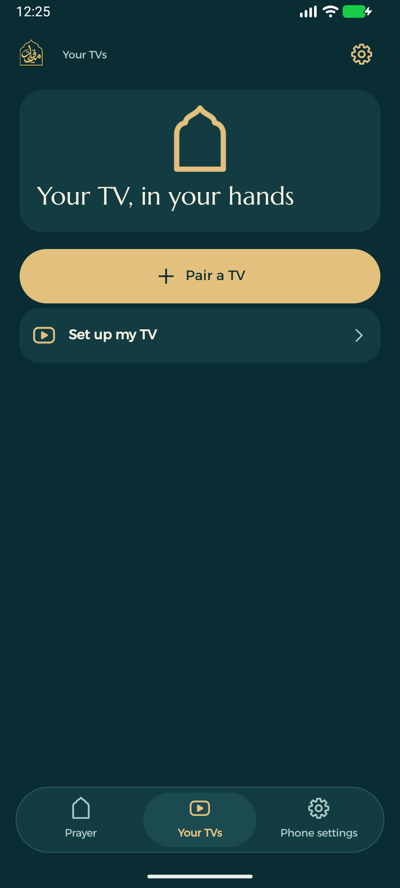

# Miqat · ميقات

Prayer times and adhan on your Android phone and the TV at home, in Arabic and English.

[Explore Miqat](https://abdelrahmanhajjaj.github.io/MiqatTV/en/) · [العربية](https://abdelrahmanhajjaj.github.io/MiqatTV/) · [Phone guide](docs/PHONE.md) · [Build and install](docs/BUILD.md)

مواقيت الصلاة والأذان على هاتف أندرويد وتلفاز البيت. استخدم الهاتف بمفرده، أو لتثبيت ميقات على التلفاز وإعداداته والتحكم فيه.

## Android phone

Use Miqat on its own; a TV is optional.

- Offline prayer times, a next-prayer card and a Hijri calendar with each selected day's timetable and recurring events.
- Per-prayer Adhan, Short tone or Silent, independent vibration, weekdays, day overrides and minute adjustments.
- Built-in voices and a named private library of recordings imported from your device; configurable level and recording length.
- Quran Radio with background listening and playback controls in its own notification.
- Qibla compass, an optional map, and resizable home-screen widgets starting at 1×1.
- Themes and backgrounds to personalise the app, with Arabic/English and adjustable text sizes.
- Prayer times for your city, with optional location updates when you travel.

[Phone setup and controls](docs/PHONE.md).

  
  
  

## TV companion mode

The same phone app has **Your TVs** for Android/Google TV and LG webOS.

- Install Miqat using the Android TV or LG setup guide.
- Pair on your home network by scanning the TV's QR code and approving with its physical remote.
- Change TV settings, preview its appearance and control Home, inputs, radio and Adhan tests.
- Keep separate prayer settings for your phone and each TV.

Pairing uses encrypted connections with revocable phone access. [Pairing and control](companion/README.md) · [Protocol](docs/COMPANION-LAN.md).

  
  
  

## On the TV

See the next prayer across the room, hear the Adhan and listen to Quran radio on your TV. Both apps include offline prayer times, reminders, Qibla direction and themes.

| Platform | What it does |
| --- | --- |
| Android phone, Android 8+ | Standalone prayers, alerts, calendar, Qibla, widgets and optional TV setup/control. |
| Android TV / Google TV | Home launcher with favourite apps and remote navigation. |
| LG webOS | Prayer times, Adhan and radio alongside embedded HDMI. |
| Website | Product screenshots and an interactive TV preview with simulated device integration. |

[Arabic TV Home](docs/screenshots/android-home-ar.png) · [LG Home](docs/screenshots/lg-home-en.png) · [Screenshot sources](docs/screenshots/README.md)

## Install

[Download Miqat](https://github.com/AbdelrahmanHajjaj/MiqatTV/releases/tag/v0.7.3) or [build from source](docs/BUILD.md). Choose the package for your device:

| Package | Purpose |
| --- | --- |
| `miqat-phone.apk` | Android phone app, including TV companion/setup mode. |
| `miqat.apk` | Android TV app. |
| `tv.miqat.webos_…_all.ipk` | LG webOS app and service. |

In the phone app's TV setup, choose **Stable** for the current release.
Android APKs use persistent release keys. Moving from an older debug-signed build
requires one fresh install, which removes local settings and imported audio.

## Privacy

No accounts, ads or analytics. Prayer calculation and city selection work offline. Optional radio, manual online prayer comparison and explicitly loaded Qibla maps use the internet. Location uses Android's permission-controlled APIs; automatic background updates are off until enabled. TV pairing/control stays on the home network. Installation separately uses ADB or LG SSH and package downloads. [Security and privacy boundaries](docs/SECURITY.md).

## Development

Start with the [documentation index](docs/README.md), [architecture](docs/ARCHITECTURE.md), [contribution guide](CONTRIBUTING.md) and [current work](docs/WORK.md). Phone, Android TV, LG and the website live in this repository and share canonical rules, data and design sources.

[MIT licence](LICENSE) · [Credits and third-party licences](docs/THIRD-PARTY.md)
