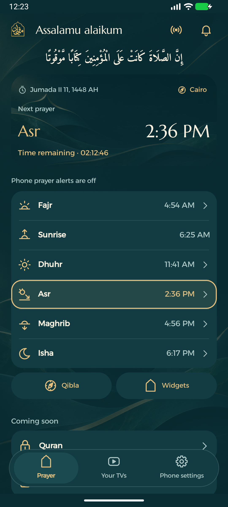
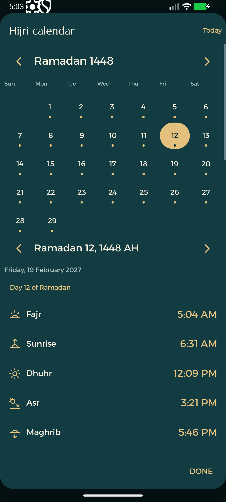

# Miqat · ميقات

Miqat shows prayer times and plays the Adhan on Android phones, Android TV and LG webOS. Use it in Arabic or English.

مواقيت الصلاة والأذان على هاتف أندرويد وتلفاز أندرويد وتلفاز إل جي، بالعربية والإنجليزية.

[Website](https://abdelrahmanhajjaj.github.io/MiqatTV/en/) · [العربية](https://abdelrahmanhajjaj.github.io/MiqatTV/) · [Download](https://github.com/AbdelrahmanHajjaj/MiqatTV/releases/latest)

| Device | What you can do | Package and setup |
| --- | --- | --- |
| Android phone (8+) | See offline prayer times, set Adhan and fasting reminders, and use the Hijri calendar, Quran Radio, Qibla and widgets. | `miqat-phone.apk` · [Phone guide](docs/PHONE.md) |
| Android TV / Google TV | Use Miqat as your Home launcher, see the next prayer and play Adhan or Quran Radio. | `miqat.apk` · [Android TV setup](docs/ANDROID-SETUP.md) |
| LG webOS | See prayer times and play Adhan or Quran Radio alongside HDMI. Install through LG Developer Mode. | `tv.miqat.webos_…_all.ipk` · [LG setup](docs/WEBOS.md) |

**Your TVs** in the Android phone app can install Miqat, pair over your home network, and control TV settings, inputs and radio. Approve pairing with the TV remote. The phone and each TV keep their own prayer settings. [Companion guide](companion/README.md)

  
  
  

[Arabic TV Home](docs/screenshots/android-home-ar.png) · [LG Home](docs/screenshots/lg-home-en.png) · [Screenshot sources](docs/screenshots/README.md)

## Privacy

Miqat has no accounts, ads or analytics. [Privacy and security](docs/SECURITY.md)

## Development

[Build from source](docs/BUILD.md) · [Docs](docs/README.md) · [Contributing](CONTRIBUTING.md) · [iPhone development](docs/IOS-WORK.md)

[MIT licence](LICENSE) · [Third-party licences](docs/THIRD-PARTY.md)
