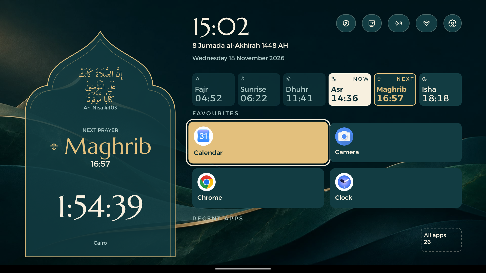
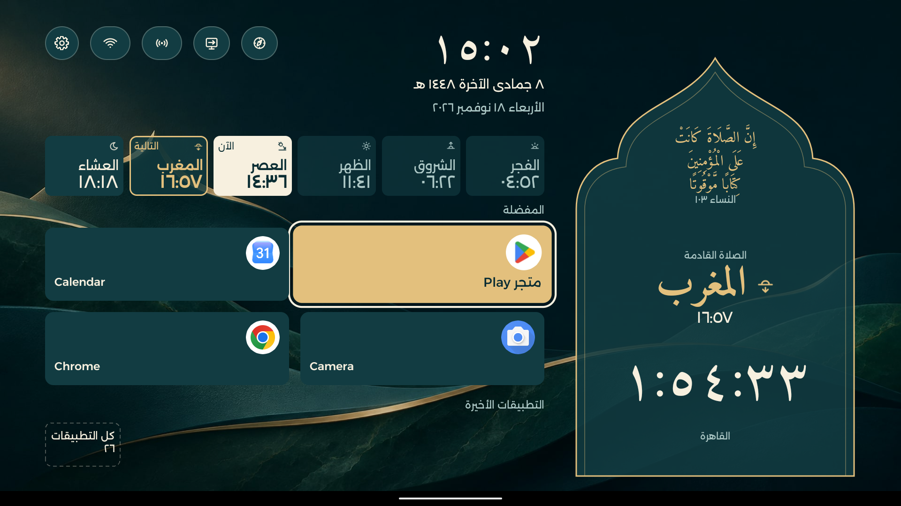

# Miqat · ميقات

Prayer times, adhan and Quran radio for the TV at home, in Arabic and English.

[Try the interactive preview](https://abdelrahmanhajjaj.github.io/MiqatTV/) · [English](https://abdelrahmanhajjaj.github.io/MiqatTV/en/)

واجهة للتلفاز تعرض مواقيت الصلاة والأذان والقبلة وإذاعة القرآن الكريم، بالعربية والإنجليزية.

- Prayer times work offline, with city, calculation method and individual adjustments.
- Adhan, reminders, Qibla, Friday and Ramadan displays.
- Theme presets, original artwork, Home layouts and adjustable interface size.
- Controls designed for a TV remote, with Arabic and English layouts.

## Screenshots

Android TV app with the default Miqat signature artwork and petrol/gold palette.
1920 × 1080 Android emulator captures.

**English Home**

**الرئيسية بالعربية**

## Platforms

| Platform | Status |
| --- | --- |
| Android TV / Google TV | Native Home launcher. The rewritten app has emulator coverage; physical-TV confirmation is pending. |
| LG webOS | Separate app with embedded HDMI. Device integration was tested on LG LF6300 / webOS 2.2; the new Miqat package needs a fresh-install check. It does not replace LG Home. |
| Browser | Interactive preview with simulated TV integration. |

Sony Android/Google TV uses the Android app. Samsung/Tizen and newer LG hardware
are unverified. The companion app is developed separately.

## Install

Build from source or use [CI test builds](docs/CI.md#checks-and-artifacts). See the
[installation and build guide](docs/BUILD.md).
Android and LG use different packages. Miqat uses new app identities and installs
as a new application. No release downloads are published from this repository yet.

## Privacy

No accounts, ads or analytics. Settings stay on the device. Prayer calculation
works offline; radio streams and the optional manual online prayer comparison
use the internet. The Android installer uses ADB during setup.

## Development

Start with the [documentation](docs/README.md), [architecture](docs/ARCHITECTURE.md)
and [contribution guide](CONTRIBUTING.md).

[MIT licence](LICENSE) · [Credits and third-party licences](docs/THIRD-PARTY.md)
