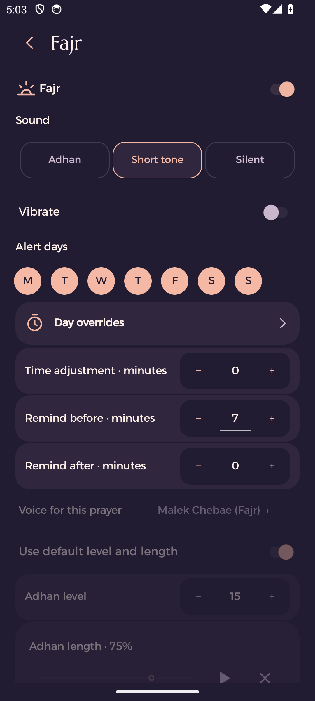
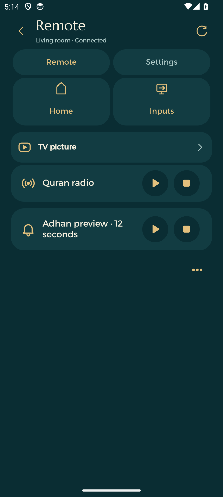
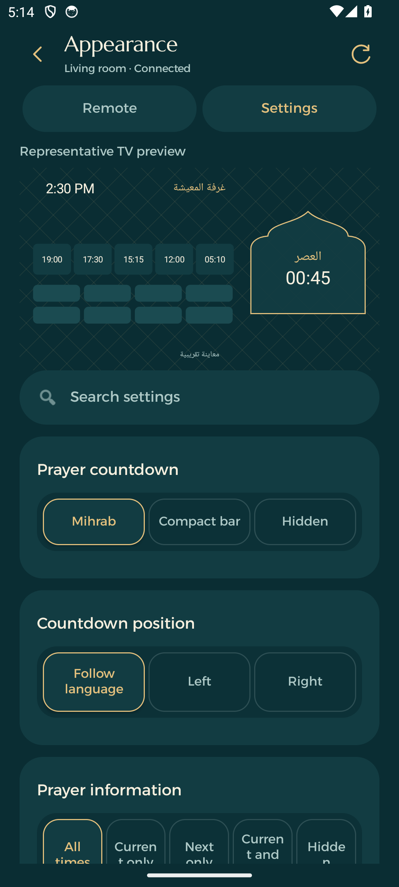

# Miqat · ميقات

Prayer times and adhan on your Android phone and the TV at home, in Arabic and English.

[Explore Miqat](https://abdelrahmanhajjaj.github.io/MiqatTV/en/) · [العربية](https://abdelrahmanhajjaj.github.io/MiqatTV/) · [Phone guide](docs/PHONE.md) · [Build and install](docs/BUILD.md)

مواقيت الصلاة والأذان على هاتف أندرويد وتلفاز البيت. استخدم الهاتف بمفرده، أو لتثبيت ميقات على التلفاز وإعداداته والتحكم فيه.

## Android phone

Use Miqat on its own; a TV is optional.

- Offline prayer times, a next-prayer card and a Hijri calendar with each selected day's timetable and recurring events.
- Per-prayer Adhan, Short tone or Silent, independent vibration, weekdays, day overrides and minute adjustments.
- Built-in voices and a named private library of recordings imported from your device; configurable level and recording length.
- Qibla compass, an optional map, and resizable home-screen widgets starting at 1×1.
- Miqat-first themes and portrait backgrounds, Arabic/English, clock/digit choices and accessible sizing.
- Manual or detected location, with optional Android-scheduled location updates while the app is closed.

Android permissions, notification channels, battery restrictions and sensor quality still apply. [Phone setup, controls and limits](docs/PHONE.md).

  
  
  

## TV companion mode

The same phone app has **Your TVs** for Android/Google TV and LG webOS.

- Follow the platform's setup guide and install a verified public build or a local APK/IPK.
- Pair on your home network by scanning the TV's QR code and approving with its physical remote.
- Change supported TV settings, preview its appearance and use explicit Home, input, radio and Adhan test controls.
- Keep phone prayer settings and each TV's settings independent. Reconnecting never uploads cached settings.

Pairing uses pinned HTTPS and individually revocable phone access. TV control is a foreground home-network feature. [Pairing and control](companion/README.md) · [Protocol and trust](docs/COMPANION-LAN.md).

  
  
  

## On the TV

Both TV apps offer offline prayer times, Adhan, reminders, Qibla bearing, Quran radio and shared Miqat themes. Home keeps the Hijri date and city in its prayer card and highlights the next prayer. Ordinary settings save immediately.

| Platform | What it does |
| --- | --- |
| Android phone, Android 8+ | Standalone prayers, alerts, calendar, Qibla, widgets and optional TV setup/control. |
| Android TV / Google TV | Native Home launcher with favourite apps, remote navigation and supported Android integration. |
| LG webOS | Separate app with embedded HDMI; it does not replace LG Home or wake from standby. Legacy integration targets LF6300 / webOS 2.2. |
| Website | Product screenshots and an interactive TV preview with simulated device integration. |

[Arabic TV Home](docs/screenshots/android-home-ar.png) · [LG browser capture](docs/screenshots/lg-home-en.png) · [Screenshot sources and limits](docs/screenshots/README.md)

Sony Android/Google TV uses the Android TV app. Samsung/Tizen, Roku and iOS apps are not implemented. LG support on newer hardware is unverified. See [current validation](docs/EVIDENCE.md) and [declared TV capabilities](docs/UI-GAPS.md).

## Install

Use [build instructions](docs/BUILD.md) or [CI test artifacts](docs/CI.md#checks-and-artifacts). Package names are distinct:

| Package | Purpose |
| --- | --- |
| `miqat-phone.apk` | Android phone app, including TV companion/setup mode. |
| `miqat.apk` | Android TV app. |
| `tv.miqat.webos_…_all.ipk` | LG webOS app and service. |
| `miqat-installer.apk` | Optional standalone Android TV setup/recovery tool; the phone app includes the same runtime. |

[Public releases](https://github.com/AbdelrahmanHajjaj/MiqatTV/releases) are the in-app download source. The current preview candidate is unpublished; no public package is available yet. Use a source build or an authorized CI artifact as a local package. CI APKs use temporary debug signing and may require a fresh install; stable signing is not configured.

## Privacy

No accounts, ads or analytics. Prayer calculation and city selection work offline. Optional radio, manual online prayer comparison and explicitly loaded Qibla maps use the internet. Location uses Android's permission-controlled APIs; automatic background updates are off until enabled. TV pairing/control stays on the home network. Installation separately uses ADB or LG SSH and package downloads. [Security and privacy boundaries](docs/SECURITY.md).

## Development

Start with the [documentation index](docs/README.md), [architecture](docs/ARCHITECTURE.md), [contribution guide](CONTRIBUTING.md) and [current work](docs/WORK.md). Phone, Android TV, LG and the website live in this repository and share canonical rules, data and design sources.

[MIT licence](LICENSE) · [Credits and third-party licences](docs/THIRD-PARTY.md)
