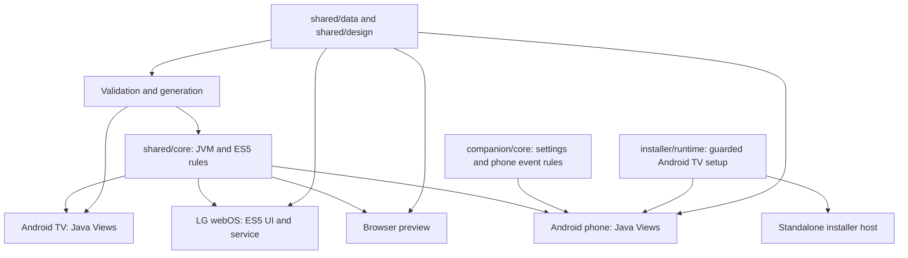

# Architecture

Miqat has a portable product core and separate applications for each platform.
The shells share rules, data and design sources; each renders its own interface
and handles its operating system.

| Project | Responsibility |
| --- | --- |
| shared/core | Prayer selection/offsets, reminders/comparison, location/quiet/Qibla/digits, UI/input and size rules. |
| shared/data | Catalog IDs, bilingual strings, calculation methods, cities, stations, voices and religious text. |
| shared/design | Tokens, themes, mihrab geometry, SVG patterns, icons, artwork, fonts and notices. |
| platforms/android-tv | Java Views, Adhan Java/ICU adapters, preferences, Home, accessibility/remote keys, scheduling and media. |
| platforms/webos | ES5 UI, Adhan JS/calendar adapters, preferences, HDMI/audio and Activity Manager service. |
| site | Browser demonstration and design-resource generators; simulated device integration. |
| companion/core | Portable settings drafts/session contracts and phone event planning. |
| companion/android | Independent prayer UI, alerts/media, location/sensors/widgets, and TV setup/control. |
| companion/android-shared | Native Android LAN trust/transport and QR helpers. |
| installer | Shared Android ADB setup/recovery library and standalone installer host. |

Core accepts explicit inputs and returns decisions. It has no platform, network,
storage, renderer or clock dependency. The JVM artifact is tv.miqat:core; JS
emits ES5 UMD under tv.miqat:core and exposes a private @miqat/core package.
Load kotlin-kotlin-stdlib.js before Miqat-core.js in browser hosts.

Define controls and choices in shared/data/ui-contract.json, then bind real
views/DOM in each shell. Core owns logical focus transitions and editor policy;
shells translate physical RTL input once and implement rendering, scrolling and
save scopes. Unsupported controls/options have explicit [gaps](UI-GAPS.md).
Shared IDs alone do not prove matching appearance or behavior.

## Platform differences

- Android can be the system Home. Its accessibility service hosts prayer checks
  and supported remote-key handling. LG does not replace Home or wake from standby.
- LG embeds HDMI within the app. Adhan uses video-only input while local audio
  plays, then restores input and volume through ownership-aware handlers.
- Android/preview replace the Fajr slot with tomorrow's after Isha. LG keeps
  today's row and exposes tomorrow's Fajr separately.
- Native alert eligibility is [0, 120000) ms late. LG accepts [0, 90000] ms,
  with persisted claims, deduplication and expiry. Shells own callback lifecycle.
- Prayer calculations remain offline and round down to whole minutes. Manual
  online comparison is advisory and never replaces the schedule or adjustments.
- LG's old calendar adapter has a finite supported range and reports unavailable
  outside it. A modern browser result does not establish old-LG compatibility.

Each project builds independently with the root Gradle wrapper and shared sources.
See [build instructions](BUILD.md), [core API](CORE.md), [data](DATA.md),
[design](DESIGN.md) and [testing](TESTING.md). Shared JS generators run sequentially.

The phone companion is maintained in this repository. Samsung/Tizen is unimplemented;
Sony Android/Google TV uses the Android shell. Current hardware limits are in
[validation evidence](EVIDENCE.md).

## Phone companion

`companion/core` owns portable settings drafts/session contracts; native phone and
TV shells own rendering, persistence and LAN transport. See [protocol boundaries](COMPANION-LAN.md)
and [separate companion scope/evidence](COMPANION-WORK.md).

The Android companion also hosts `installer/runtime` through a private setup
activity. The standalone installer uses that same implementation. Installation
credentials/recovery records live in the hosting app's private storage, separately
from ordinary companion LAN credentials; the two installed apps do not share
private files. LG phone setup uses its own foreground SSH transport, explicit
host-key approval and local IPK verification; keys/passphrases remain session-only.
Phone prayer/iOS work is sequenced in [WORK.md](WORK.md).

### Independent phone prayer runtime

Phone-only metadata is canonical in `shared/data/phone-ui-contract.json`, with
portable phone event/next-prayer policy in `companion/core`. Common location,
quiet-hour, display-digit and Qibla bearing rules live in `shared/core` for JVM/ES5. `PhoneSchedule` adapts
the pinned TV Adhan source using explicit civil timezone inputs. `PhoneStore`
validates and persists phone-only preferences/claims in device-protected storage;
backup and transfer exclude it. TV credentials stay in their encrypted store.
`PhoneAlarms` keeps one next exact event when access is allowed, an explicitly
approximate inexact fallback otherwise, plus a daily recovery check when needed. The private receiver reschedules after boot/time changes and durably
claims eligible events before output. `PhonePlayback` is a private, non-sticky
foreground service only during approved local playback, with focus loss, Stop,
timeout and permission/settings cleanup. `PhoneUi` coordinates phone settings;
PhoneHome, PhoneLocationUi, PhoneAppearance, PhoneOnboarding and PhoneSound own
their respective native journeys. PairingUi/TvSettingsUi/TvRemoteUi/TvListUi own
TV workflows, while transports keep networking/trust separate. QiblaUi owns
foreground sensors and opt-in, attributed map loading. PhoneCalendar maps Hijri
month selection back to civil dates for the real prayer engine. WidgetUi owns immediate configuration, WidgetOptions per-instance
presentation, WidgetRenderer native RemoteViews, and PrayerWidget the existing
schedule/launcher update lifecycle plus exact-size maps/legacy resize bounds.
Allocated dimensions determine compact/next/daily detail; stored presets remain
initial presentations and styles are independent. PhoneDayOverrides renders each
weekday's controls in place. Native receiver variants share that provider.
`PhoneHijriEvents` adapts the canonical recurring event catalog to corrected ICU
calendar dates; `companion/core` selects current/upcoming events from explicit
inputs. The exact Home verse is projected from the existing TV source.
`PhoneBackgroundPermission` owns fresh optional consent. `PhoneLocationJob` owns
one bounded OS location request per persisted periodic job; `PhoneBackgroundLocation`
gates permission/opt-in and rejects fixes invalidated by newer user calibration.
No continuous foreground service or application network transport is added.
Neither phone settings nor alarm recovery connect to a TV.
See [phone guide and limits](PHONE.md) and [delivery ledger](PHONE-WORK.md).

PhoneAudio/PhoneAudioLibrary retain immutable private recordings and an atomic
named index, separate from portable settings' selected hashes. PhoneAlertTest owns
an independent elapsed-time/boot-scoped one-shot claim; explicit delivery tests
never replace the real schedule. PhoneTestUi owns its countdown/cancel actions.

PhoneVolume temporarily owns only the chosen stream index, deriving the nearest
positive step from PhonePrayerRules.volumeIndex and the OS maximum. A private
restore record is committed before changing it. Pause/stop/failure releases it
only if the current index is still Miqat's applied value. A manual change is
preserved; unchanged settings do not reassert volume. Recovery after process
death runs at the next Miqat entry. No extra service or network work is added.

PlaybackWave renders the Home card's bounded foreground animation and canonical
playback-controls action. It captures no audio and respects Android and retained
motion preferences. The resumed MainActivity can open the opted-in Adhan screen
without relying on lock-screen intents. Background presentation remains owned by
Android. Playback notifications retain their MediaSession token and standard
playback controls in a non-MediaStyle alert, enabling supported system swipes.
The compact notification uses the system template. Its decorated expanded view
uses localized icon controls and a wrapping recording label; one native progress
bar remains. The recording name is resolved from the actual playing file's
library identity once per session, including unsaved custom auditions.
Core prayer alarms declare USE_EXACT_ALARM on Android 13+, with the legacy
SCHEDULE_EXACT_ALARM declaration limited to Android 12. Notification permission
and user prayer opt-outs still gate delivery; the audio stream toggle is separate.
