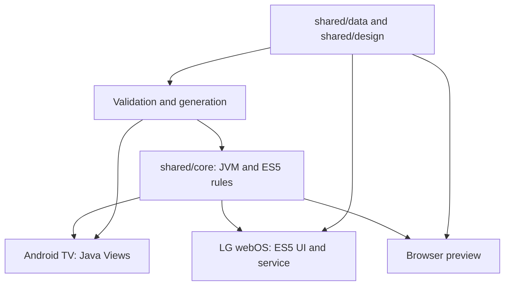

# Architecture

Miqat has a portable product core and separate applications for each platform.
The shells share rules, data and design sources; each renders its own interface
and handles its operating system.

| Project | Responsibility |
| --- | --- |
| shared/core | Prayer minute flooring/selection/offsets, reminder/comparison rules, UI controls and numeric editing, semantic Home/All apps navigation, size policy. |
| shared/data | Catalog IDs, bilingual strings, calculation methods, cities, stations, voices and religious text. |
| shared/design | Tokens, themes, mihrab geometry, SVG patterns, icons, artwork, fonts and notices. |
| platforms/android-tv | Java Views, Adhan Java/ICU adapters, preferences, Home, accessibility/remote keys, scheduling and media. |
| platforms/webos | ES5 UI, Adhan JS/calendar adapters, preferences, HDMI/audio and Activity Manager service. |
| site | Browser demonstration and design-resource generators; simulated device integration. |
| installer | Android phone ADB setup and recovery. |

Core accepts explicit inputs and returns decisions. It has no platform, network,
storage, renderer or clock dependency. The JVM artifact is tv.miqat:core; JS
emits ES5 UMD under tv.miqat:core and exposes a private @miqat/core package.
Load kotlin-kotlin-stdlib.js before Miqat-core.js in browser hosts.

Define controls and choices in shared/data/ui-contract.json, then bind real
views/DOM in each shell. Core owns logical focus transitions and editor policy;
shells translate physical RTL input once and implement rendering, scrolling and
save scopes. Unsupported controls/options have explicit [gaps](UI-GAPS.md).
Shared IDs alone do not prove matching appearance or behavior.

## Platform differences

- Android can be the system Home. Its accessibility service hosts prayer checks
  and supported remote-key handling. LG does not replace Home or wake from standby.
- LG embeds HDMI within the app. Adhan uses video-only input while local audio
  plays, then restores input and volume through ownership-aware handlers.
- Android/preview replace the Fajr slot with tomorrow's after Isha. LG keeps
  today's row and exposes tomorrow's Fajr separately.
- Native alert eligibility is [0, 120000) ms late. LG accepts [0, 90000] ms,
  with persisted claims, deduplication and expiry. Shells own callback lifecycle.
- Prayer calculations remain offline and round down to whole minutes. Manual
  online comparison is advisory and never replaces the schedule or adjustments.
- LG's old calendar adapter has a finite supported range and reports unavailable
  outside it. A modern browser result does not establish old-LG compatibility.

Each project builds independently with the root Gradle wrapper and shared sources.
See [build instructions](BUILD.md), [core API](CORE.md), [data](DATA.md),
[design](DESIGN.md) and [testing](TESTING.md). Shared JS generators run sequentially.

Companion work is outside this repository foundation. Samsung/Tizen is unimplemented;
Sony Android/Google TV uses the Android shell. Current hardware limits are in
[validation evidence](EVIDENCE.md).

## Phone companion

`companion/core` owns portable settings drafts/session contracts; native phone and
TV shells own rendering, persistence and LAN transport. See [protocol boundaries](COMPANION-LAN.md)
and [separate companion scope/evidence](COMPANION-WORK.md).
